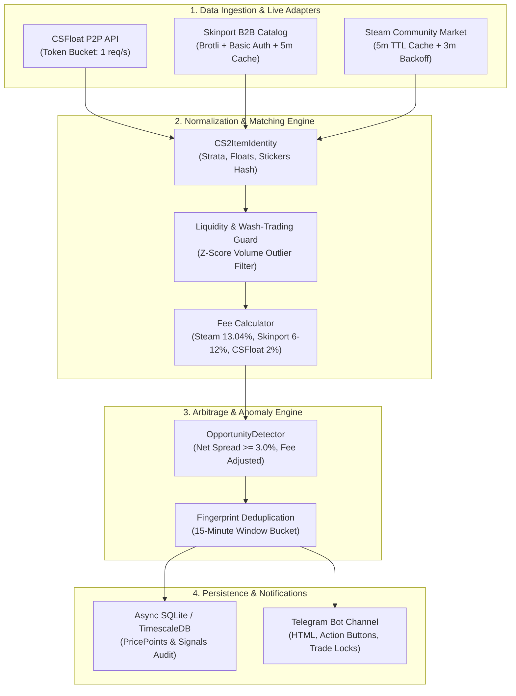

# 🎯 Autonomous Digital Collectibles Monitoring & Arbitrage System (`collectibles-monitor`)

[](https://github.com/pegasovich/skins_monitor/actions/workflows/ci.yml)
[](https://www.python.org/downloads/)
[](https://github.com/astral-sh/ruff)
[](http://mypy-lang.org/)
[](https://github.com/pegasovich/skins_monitor)
[](https://opensource.org/licenses/MIT)

An enterprise-grade, asynchronous price monitoring, liquidity evaluation, and triangular arbitrage detection engine for digital collectibles and in-game assets (**Counter-Strike 2 / CS2 skins**).

Engineered with strict financial accuracy (zero float math via `decimal.Decimal`), platform fee deduction matrices, intelligent token-bucket rate limiting, circuit breaker fault isolation, and rich Telegram bot alerts with interactive action buttons.

---

## ⚡ Key Capabilities & Architecture



* **Financial Determinism:** 100% precision with `decimal.Decimal`. Zero floating-point rounding errors on fiat calculations.
* **CS2 Asset Domain Model:** Full support for wear strata (`Factory New` to `Battle-Scarred`), exact float value classification, Stattrak/Souvenir flags, and unlimited custom sticker slots (supporting the CS2 update).
* **Multi-Market Net Arbitrage:** Evaluates gross and net profit margins across **Skinport**, **CSFloat**, and **Steam Community Market** after deducting all buyer/seller commissions and payout fees.
* **Resilient Distributed HTTP Client:** Connection pooling, automatic Brotli (`br`) compression, Token-Bucket per-source rate limiting, and Circuit Breakers (`CLOSED`, `OPEN`, `HALF_OPEN`).
* **Polite Exponential Backoff:** Automatically handles HTTP 429 (`Too Many Requests`), backing off and using in-memory TTL caches to protect local IP addresses from vendor cooldowns.
* **Interactive Telegram Alerts:** Dispatches styled HTML notifications with trade-lock risk warnings and direct inline market action buttons (`[ 🛒 Buy on CSFLOAT ]` and `[ 🏷 Sell on STEAM ]`).

---

## 📊 Platform Fee Matrix Model

Net proceeds and arbitrage spreads are calculated using the exact platform fee tiers:

| Marketplace | Buy Fee | Sell Fee | Cashout / Payout Fee | Effective Deduction |
|---|---|---|---|---|
| **Steam Community Market** | 0% | 5.0% (Valve) + 10.0% (CS2) | N/A (Steam Wallet) | **~13.04%** |
| **Skinport** | 0% | 12.0% ($< \$1,000$) / 6.0% ($\ge \$1,000$) | 0% (SEPA / Wire) | **6.0% – 12.0%** |
| **CSFloat** | 0% | 2.0% Flat Fee | 0% – 2.5% (Stripe / Crypto) | **2.0% – 4.5%** |

---

## 🛠️ Tech Stack & Prerequisites

* **Runtime:** Python 3.12+ (standardized for production and CI)
* **Async Framework:** `asyncio`, `httpx` (HTTP/2 ready), `tenacity`
* **Data Validation & Typing:** `pydantic` v2, `pydantic-settings`, `mypy --strict`
* **Logging & Observability:** `structlog` (structured JSON / key-value console logs)
* **Code Quality & Tooling:** `ruff` (linter & formatter), `pytest`, `pytest-cov`, `pytest-asyncio`, `respx`
* **Containerization:** `Docker`, `docker-compose`

---

## 🚀 Quickstart Guide

### 1. Clone the Repository
```bash
git clone https://github.com/pegasovich/skins_monitor.git
cd skins_monitor
```

### 2. Environment Configuration
Copy the sample environment file:
```bash
copy .env.example .env     # On Windows PowerShell
cp .env.example .env       # On Linux / macOS
```

Open `.env` and configure your credentials:
```env
# Operating Mode
ENVIRONMENT=production
DRY_RUN=false
STOP_ALL_OUTBOUND=false
LOG_LEVEL=INFO

# Arbitrage Strategy Filters
MIN_NET_SPREAD_PCT=3.0     # Minimum net profit margin after fees (e.g. 3.0%)
MIN_PRICE_USD=5.0          # Minimum skin price filter
MAX_PRICE_USD=500.0        # Maximum skin price filter

# Telegram Alerting
TELEGRAM_BOT_TOKEN=your_telegram_bot_token
TELEGRAM_CHAT_ID=your_telegram_chat_id

# Market API Credentials
SKINPORT_CLIENT_ID=your_skinport_client_id
SKINPORT_CLIENT_SECRET=your_skinport_client_secret
CSFLOAT_API_KEY=your_csfloat_api_key
```

### 3. Windows 1-Click Launch
On Windows, simply double-click or run:
```powershell
.\run.bat
```
*(Or run `.\run.ps1` in PowerShell)*

### 4. Manual Installation (Linux / macOS / Windows)
```bash
python -m venv .venv
source .venv/bin/activate       # On Linux/macOS
.\.venv\Scripts\activate       # On Windows

pip install --upgrade pip setuptools wheel
pip install -e ".[dev]"

# Launch the orchestrator daemon
python -m collectibles.main
```

### 5. Docker Deployment (24/7 Server / VPS)
```bash
docker compose up -d
docker compose logs -f monitor
```

---

## ⚙️ Search Strategy & Filters

The system uses an **intelligent alternating scan pattern**:
* **Even Cycles:** Queries `sort_by="highest_discount"` on CSFloat to catch items with massive existing discounts (-15% to -40%).
* **Odd Cycles:** Queries `sort_by="most_recent"` on CSFloat with `type="buy_now"` to instantly snipe mispriced items in the first seconds of listing.
* **Target Price Band:** Filters out low-value clutter (< \$5) and high-capital risks (> \$500).
* **Steam Benchmark Caching:** Caches retrieved Steam market prices for 5 minutes (`TTL=300s`), slashing outgoing requests by 85% and preventing IP rate-limits.

---

## 🧪 Testing & Quality Verification

All commits are automatically validated against strict CI Quality Gates on GitHub Actions:

```bash
# 1. Format & Lint checks
ruff format --check .
ruff check .

# 2. Strict static typing
mypy --strict src

# 3. Unit, integration & network-mock test suite (42 tests, >=80% coverage)
pytest --cov=src --cov-fail-under=80
```

---

## 📁 Repository Structure

```text
skins_monitor/
├── .github/workflows/       # GitHub Actions CI workflow (Python 3.12, Ruff, Mypy, Pytest)
├── docs/adr/                # Architecture Decision Records (0001-0004)
├── scripts/                 # Operational smoke tests and verification helpers
├── src/collectibles/
│   ├── alerts/              # Notification engines (Telegram with action buttons, Console)
│   ├── analyzer/            # Net spread calculator, backtester, detector, liquidity guards
│   ├── core/                # Models (Decimal), identity hashing, circuit breaker, rate limiter
│   ├── providers/           # Live market adapters (Skinport, CSFloat, Steam, BaseProvider)
│   ├── storage/             # SQLite / TimescaleDB persistence repositories
│   └── main.py              # Master daemon orchestrator & ingestion loop
├── tests/                   # 42 unit and integration tests with respx mocks
├── docker-compose.yml       # Production docker service definition
├── Dockerfile               # Optimized Python 3.12 slim container
├── run.bat / run.ps1        # Fast Windows quick-launchers
└── pyproject.toml           # PEP 621 dependencies & project metadata
```

---

## 🛡️ Security & Terms of Service (ToS) Compliance

* **Documented APIs Only:** Operates strictly via official, sanctioned REST APIs (Skinport Developer API, CSFloat Partner API, Steam Community Market Overview).
* **Zero Anti-Bot Circumvention:** Never bypasses Cloudflare, never automates CAPTCHAs, and respects all HTTP 429 backoff headers.
* **Secrets Isolation:** Plaintext tokens and keys are strictly kept inside local `.env` files and permanently excluded from version control via `.gitignore`.

---

## 📜 License

Licensed under the [MIT License](LICENSE).
